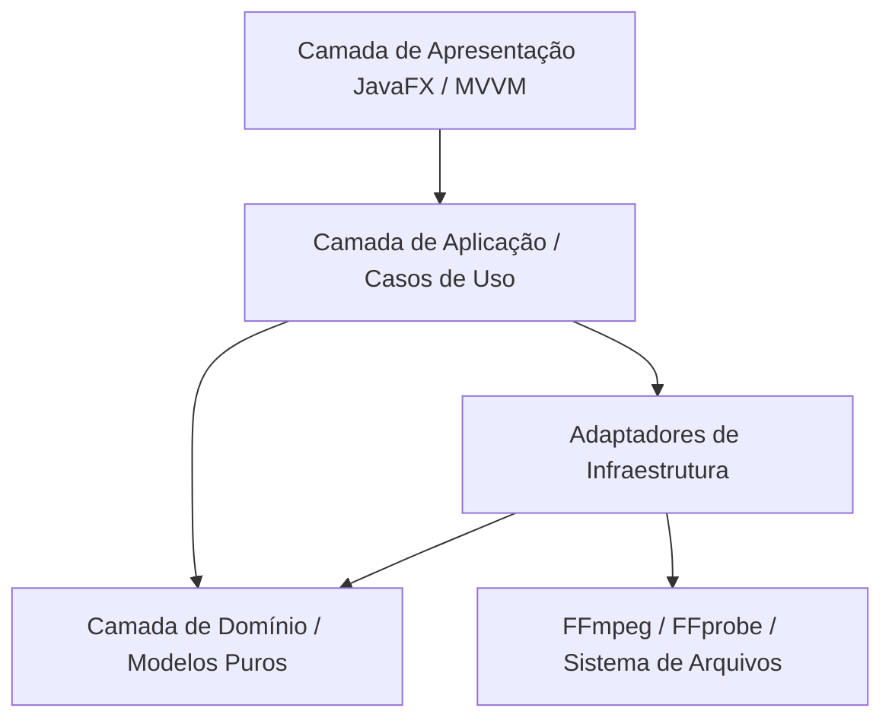

# Arquitetura do FFmpeg Studio

O **FFmpeg Studio** adota uma variante da **Arquitetura Hexagonal (Ports and Adapters)** combinada com **Model-View-ViewModel (MVVM)** para a camada de apresentação desktop.

---

## 1. Princípios Arquiteturais

### Desacoplamento do Domínio
O núcleo de negócio (`com.ffmpegstudio.domain`) não possui qualquer dependência com frameworks de interface gráfica (`javafx.*`), APIs nativas ou bibliotecas de terceiros como Jackson. O modelo é expresso em `records` imutáveis e interfaces (`Ports`).

### Segurança na Execução de Processos
A camada de infraestrutura (`FFmpegProcessExecutor` e `FFmpegCommandBuilder`) proíbe rigorosamente concatenações de strings para shell. Toda chamada utiliza `java.lang.ProcessBuilder` passando `List<String>`, blindando o software contra vulnerabilidades de injeção de parâmetros ou problemas com espaços e caracteres Unicode em nomes de arquivos.

### Modelo Assíncrono e Responsividade
Processos demorados como codificação de vídeo, probes e leitura de filtros nunca são executados na thread principal da interface gráfica (`JavaFX Application Thread`). O utilitário `AsyncHelper` despacha tarefas para um pool de threads gerenciado e atualiza a interface via `Platform.runLater()`.

---

## 2. Camadas do Sistema

### 1. Domínio (`com.ffmpegstudio.domain`)
- **`model`**:
  - `ExecutableInfo`: Estado de disponibilidade e versão de um executável no sistema.
  - `CodecInfo`: Informações sobre codecs e suas capacidades (áudio, vídeo, decodificação, codificação).
  - `FFmpegCapabilities`: Matriz de acelerações de hardware, encoders, decoders e filtros disponíveis.
  - `AppSettings`: Configurações de diretórios, concorrência e caminhos de binários.
  - `MediaFile`, `MediaMetadata`, `MediaStream`, `VideoStream`, `AudioStream`, `SubtitleStream`, `ChapterInfo`: Modelos imutáveis para representação técnica de mídias inspecionadas.
  - `ConversionSettings`, `ContainerFormat`, `VideoCodecOption`, `AudioCodecOption`, `PresetSpeed`, `ResolutionPreset`: Parâmetros imutáveis de transcodificação.
  - `ConversionPreset`: Definições predefinidas de receitas de conversão reutilizáveis e exportáveis.
  - `MediaOperation`: Abstração unificada para qualquer operação de mídia executável pelo motor compartilhado.
  - `TranscodeOperation`, `CompressOperation`, `AudioToolsOperation`, `TrimOperation`, `GenerateGifOperation`, `ExtractFramesOperation`, `PeriodicFramesOperation`, `ImageConversionOperation`, `ConcatOperation`, `SubtitleOperation`, `FilterOperation`, `StreamOperation`, `MetadataOperation`: Especializações tipadas com validação e geração de argumentos.
  - `LoudnormMetrics`: Métricas medidas da 1ª passagem EBU R128 para normalização linear em 2 passagens.
  - `WorkspaceMedia`: Modelo de item de mídia referenciado no workspace compartilhado.
  - `JobHistoryEntry`: Snapshot serializável de histórico de fila com whitelist fechada de operações permitidas (`ALLOWED_OPERATION_TYPES`).
  - `com.ffmpegstudio.domain.model.filter`: Motor tipado de filtros (`MediaFilter`, `VideoFilters`, `AudioFilters`, `FilterGraphBuilder`, `FilterValidationResult`, `PreviewResult`).
  - `HardwareBackend`, `HardwareEncoderProbeResult`, `HardwareProbeReport`: Modelos de verificação em 3 níveis de aceleração por hardware.
  - `OtherStream`: Representação de streams `data` e `attachment` além de `VideoStream`, `AudioStream` e `SubtitleStream`.
  - `ConversionValidator`: Validação de regras e compatibilidades de conversão.
  - `JobStatus`, `ProcessingJob`, `ProcessingProgress`: Estados da fila (incluindo `INTERRUPTED`), progresso e máquina de estados das tarefas.
- **`port`**:
  - `CapabilityDetectorPort`: Interface de detecção de capacidades.
  - `MediaInspectionPort`: Interface de inspeção com FFprobe.
  - `SettingsRepositoryPort`: Interface de persistência de configurações.
  - `PresetRepositoryPort`: Interface de armazenamento e exportação/importação de presets.
  - `QueueHistoryRepositoryPort`: Interface de persistência da fila pendente e histórico de tarefas.
  - `ProcessExecutorPort`: Interface segura de execução de processos do sistema operacional.

### 2. Aplicação (`com.ffmpegstudio.application`)
- **`port.in`**:
  - `DetectCapabilitiesUseCase`
  - `AnalyzeMediaUseCase`
  - `TranscodeMediaUseCase`
  - `ManagePresetsUseCase`
  - `ManageQueueUseCase`
  - `ManageSettingsUseCase`
- **`service`**:
  - `DetectCapabilitiesService` (com cache e invalidação explícita)
  - `AnalyzeMediaService`
  - `TranscodeMediaService`
  - `PresetService`
  - `JobQueueService` (com persistência, recuperação de `INTERRUPTED` e duplicação)
  - `MediaLibraryService`
  - `MediaPreviewService`
  - `FilterPreviewService`
  - `HardwareAccelerationService`
  - `FailureClassifier`
  - `DiagnosticsService`
  - `SettingsService`

### 3. Infraestrutura (`com.ffmpegstudio.infrastructure`)
- **`ffmpeg`**:
  - `FFmpegProcessExecutor`: Gerenciador de processos com streaming assíncrono de progresso, cancelamento gracioso com controle de processos descendentes e limpeza segura de arquivos temporários.
  - `FFmpegCommandBuilder`: Construtor determinístico de argumentos para `ProcessBuilder`.
  - `FFmpegProgressParser`: Analisador de métricas do protocolo `-progress pipe:1`.
  - `LoudnormMetricsParser`: Extrator do bloco JSON de estatísticas da 1ª passagem `loudnorm`.
  - `FFprobeClient`: Parser de JSON estruturado do FFprobe com resiliência a valores faltantes e frações de taxa de quadros.
  - `FFmpegCapabilityDetector`: Analisador de capacidades e versões de ferramentas instaladas.
- **`config`**:
  - `JsonSettingsRepository`: Armazenamento seguro de preferências do usuário em formato JSON (`~/.config/ffmpeg-studio/settings.json`).
  - `JsonPresetRepository`: Armazenamento, exportação e importação de biblioteca de presets (`~/.config/ffmpeg-studio/presets.json`) com preservação de presets de fábrica.
  - `JsonQueueHistoryRepository`: Armazenamento persistente de tarefas da fila e histórico (`~/.config/ffmpeg-studio/queue-history.json`).
- **`filesystem`**:
  - `FileSystemService`: Resolução de caminhos, validação de permissões de execução e localização de binários na variável `PATH`.

### 4. Apresentação (`com.ffmpegstudio.ui`)
- **MVVM**:
  - **Controllers**: `MainLayoutController`, `DashboardController`, `WorkspaceController`, `ConverterController`, `CompressionController`, `ToolsController`, `ConcatController`, `SubtitlesController`, `FiltersController`, `StreamsMetadataController`, `QueueController`, `HistoryController`, `SettingsController`.
  - **ViewModels**: `MainViewModel`, `DashboardViewModel`, `ConverterViewModel`, `CompressionViewModel`, `ToolsViewModel`, `ConcatViewModel`, `SubtitlesViewModel`, `FiltersViewModel`, `StreamsMetadataViewModel`, `QueueViewModel`, `SettingsViewModel`.
  - **Views**: Arquivos declarativos FXML (`main-layout.fxml`, `dashboard.fxml`, `workspace.fxml`, `converter.fxml`, `compression.fxml`, `tools.fxml`, `concat.fxml`, `subtitles.fxml`, `filters.fxml`, `streams-metadata.fxml`, `queue.fxml`, `history.fxml`, `settings.fxml`) com estilização através de folhas de estilo CSS (`dark-theme.css`, `light-theme.css`) e internacionalização (`I18n` com `pt_BR` e `en`).
  - **Componentes Visuais**: `UiComponents`, `IconHelper` (ícones vetoriais SVG desenhados através de `SVGPath` com cores dinâmicas orientadas por estado).
